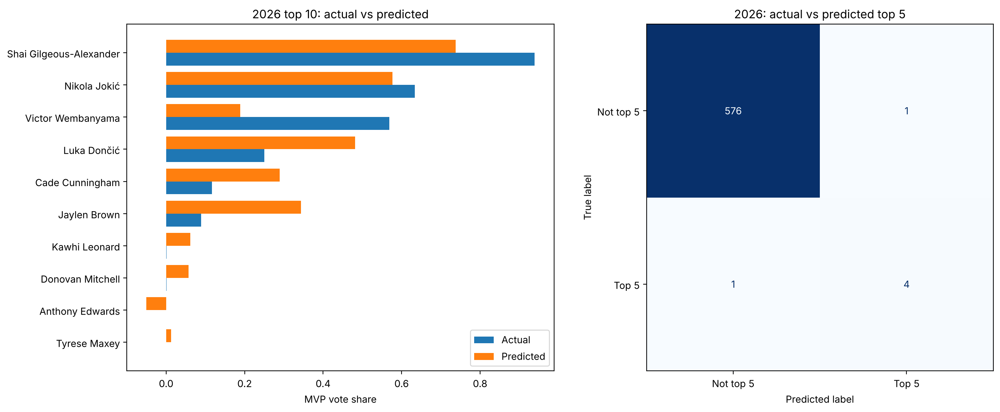

# NBA MVP Prediction

Predicting NBA MVP voting from player and team stats: scraped from scratch, cleaned, modeled with LightGBM, and tested on two seasons the model never saw.

| Season (unseen) | Predicted MVP | Actual MVP | Real top 5 found |
|---|---|---|---|
| **2025** | Shai Gilgeous-Alexander | Shai Gilgeous-Alexander ✅ | **4 / 5** (top 4 in the exact order) |
| **2026** | Shai Gilgeous-Alexander | Shai Gilgeous-Alexander ✅ | **4 / 5** (top 2 in the exact order) |

The model reliably finds the top contenders, but it underrates players whose case rests on defense or advanced stats (see [Limitations](#limitations--future-work)).


---

## Problem

Every season, about 100 journalists vote for the NBA's Most Valuable Player. Each player's **vote share** (points won ÷ maximum possible points) is the target.
The model predicts every player's vote share from that season's stats; the player with the highest prediction is the predicted MVP.

## Pipeline

| Notebook | What it does |
|---|---|
| [`01_web_scraping.ipynb`](01_web_scraping.ipynb) | Downloads MVP voting, player per-game stats and team standings for 1991–2025 from basketball-reference.com (rate-limited, cached as raw HTML) |
| [`02_data_cleaning.ipynb`](02_data_cleaning.ipynb) | Merges the three tables into one row per player-season (16,377 rows), fixes data issues, explores the data |
| [`tune_hyperparameters.py`](tune_hyperparameters.py) | Picks LightGBM hyperparameters with rolling validation on 1991–2024 only; writes `best_params.json` |
| [`03_machine_learning.ipynb`](03_machine_learning.ipynb) | Feature engineering, LightGBM training, evaluation on 2025, saves the final model |
| [`04_test_2026_season.ipynb`](04_test_2026_season.ipynb) | Scrapes and cleans the 2026 season, loads the saved model, evaluates on 2026 |

## Approach

**Data.** 35 seasons (1991–2025): per-game box-score stats (points, rebounds, assists, shooting, ...) and team record (wins, win %, point differential).

**Features.** 41 features: the raw stats plus **era-normalized** versions (each stat ÷ that season's league average), since 25 points per game means more in a low-scoring era. Columns that contain the answer (`Pts Won`, `Pts Max`, and the site's `Awards` column, which literally says `MVP-1`) are excluded.

**Model.** A LightGBM regressor with small, regularized trees. Hyperparameters come from `tune_hyperparameters.py`: a random search of 40 settings, each scored by training on all earlier seasons and predicting one season, for every season from 2015 to 2024. The 2025 and 2026 seasons are never used for tuning (`best_params.json`).

**Validation.** Split by season, not randomly: a random split would train on future seasons and break up each season's MVP race.
- Train on 1991–2024, test on **2025**.
- Then retrain on 1991–2025, save the model, and test it on **2026**, a season it has never seen.

## Results

### 2025 (held-out test)

| Player | Predicted share | Actual share | Predicted rank | Actual rank |
|---|---|---|---|---|
| Shai Gilgeous-Alexander | 0.860 | 0.913 | 1 | 1 |
| Nikola Jokić | 0.602 | 0.787 | 2 | 2 |
| Giannis Antetokounmpo | 0.365 | 0.470 | 3 | 3 |
| Jayson Tatum | 0.197 | 0.311 | 4 | 4 |
| Trae Young | 0.109 | 0.000 | 5 | 26 |
| Donovan Mitchell | 0.086 | 0.074 | 6 | 5 |

R² = 0.93, RMSE = 0.014. The model misses one of the real top 5: it ranks Trae Young 5th and Donovan Mitchell 6th. The loss curve shows train and test loss falling together, with no overfitting:


### 2026 (new season, saved model used without changes)

| Player | Predicted share | Actual share | Predicted rank | Actual rank |
|---|---|---|---|---|
| Shai Gilgeous-Alexander | 0.738 | 0.939 | 1 | 1 |
| Nikola Jokić | 0.577 | 0.634 | 2 | 2 |
| Luka Dončić | 0.481 | 0.250 | 3 | 4 |
| Jaylen Brown | 0.343 | 0.089 | 4 | 6 |
| Cade Cunningham | 0.289 | 0.117 | 5 | 5 |
| Victor Wembanyama | 0.189 | 0.569 | 6 | 3 |



The model gets the MVP and the top two right. Its one miss is Wembanyama (predicted 0.19, actual 0.57, ranked 6th by the model but 3rd in the vote), and Jaylen Brown is the false alarm (predicted 4th, finished 6th). Across all players in the 2026 table: R² = 0.78, RMSE = 0.025.

## What I learned / issues found

- **Silent data loss.** The site changed how traded players are labeled (`TOT` → `2TM`/`3TM`). Following the original tutorial dropped **~1,900 player-seasons** without any error. Found by checking *which* rows had missing values, not just how many.
- **Encoding bugs break joins.** MVP pages decoded as Latin-1 turned `Jokić` into `JokiÄ`, so Jokić's MVP seasons had no stats. Filling missing values with 0 would have taught the model that MVPs score 0 points.
- **Leakage hides in plain sight.** The player table's `Awards` column contains `MVP-1`.
- **Tune on seasons you do not test on.** The first version used hard-coded hyperparameters with no tuning code, so they could have been chosen while looking at 2025. Re-tuning with rolling validation on 1991–2024 only moved the 2025 top-5 result from 5/5 to 4/5, which is the number to trust.

## Limitations & future work

- **No advanced or defensive stats.** The biggest miss (Victor Wembanyama in 2026) is a player whose value shows up in Win Shares, BPM or defensive impact, not in box scores. Adding basketball-reference's advanced stats table is the clear next step.
- **Narrative isn't in the data.** Voters also weigh storylines (comebacks, team surprises) that stats can't capture.
- **Eligibility rules.** Since 2024, players need 65 games to be MVP-eligible; the model learns this only indirectly.
- **Deployment.** Serve the saved model through a small API / web app.

## How to run

```bash
git clone https://github.com/omshivbhosale/nba-mvp-prediction.git
cd nba-mvp-prediction
pip install -r requirements.txt
jupyter nbconvert --to notebook --execute --inplace 03_machine_learning.ipynb   # or open the notebooks in Jupyter / VS Code
```

Run the notebooks in order. The processed CSVs and the trained model (`mvp_model.joblib`) are included, so you can start directly at `03_machine_learning.ipynb`.
Notebook 01 re-downloads ~105 pages (about 15 minutes because of the site's rate limit).

On macOS, LightGBM needs OpenMP: `brew install libomp`.

## Project structure

```
├── 01_web_scraping.ipynb
├── 02_data_cleaning.ipynb
├── 03_machine_learning.ipynb
├── 04_test_2026_season.ipynb
├── tune_hyperparameters.py  # hyperparameter search on 1991–2024
├── best_params.json         # its output, loaded by notebook 03
├── mvps.csv                 # MVP voting, 1991–2025
├── players.csv              # player per-game stats, 1991–2025
├── teams.csv                # team standings, 1991–2025
├── nicknames.txt            # team abbreviation -> full name
├── player_mvp_stats.csv     # cleaned, merged dataset (16,377 player-seasons)
├── mvp_model.joblib         # final LightGBM model + feature list
├── images/                  # charts used in this README
└── requirements.txt
```

Raw HTML pages (`mvp/`, `player/`, `team/`, `data_2026/`) are not committed; notebook 01 recreates them.

## Data source

All data comes from [Basketball Reference](https://www.basketball-reference.com) (Sports Reference LLC) and is used for educational purposes. Please respect their [bot traffic](https://www.sports-reference.com/bot-traffic.html) and [data use](https://www.sports-reference.com/data_use.html) policies if you re-scrape.

Based on Dataquest's [Web Scraping NBA Stats With Python](https://www.youtube.com/watch?v=JGQGd-oa0l4) tutorial, extended with data-quality fixes, era-normalized features, a LightGBM model, and tests on the unseen 2025 and 2026 seasons.
