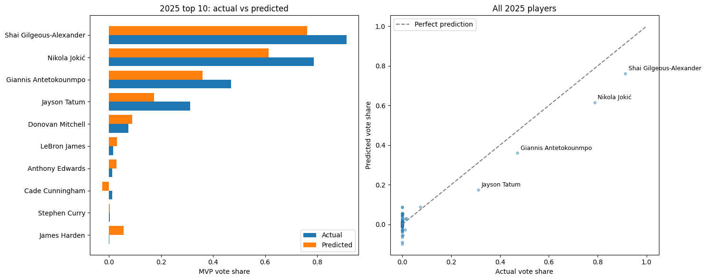
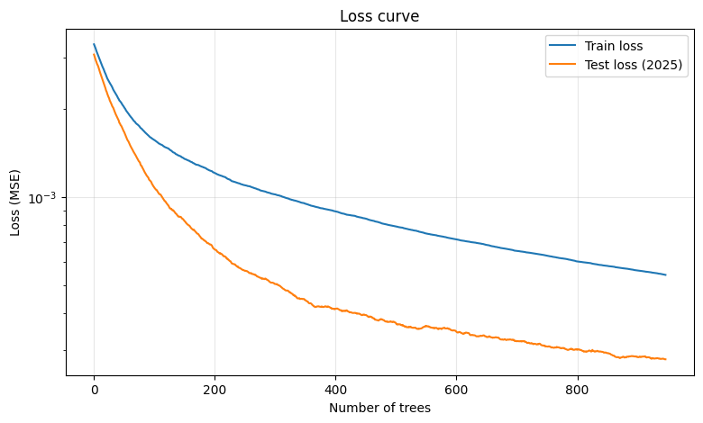

# NBA MVP Prediction

Predicting NBA MVP voting from player and team stats: scraped from scratch, cleaned, modeled with LightGBM, and tested on two seasons the model never saw.

| Season (unseen) | Predicted MVP | Actual MVP | Real top 5 found |
|---|---|---|---|
| **2025** | Shai Gilgeous-Alexander | Shai Gilgeous-Alexander ✅ | **5 / 5** (in the exact order) |
| **2026** | Shai Gilgeous-Alexander | Shai Gilgeous-Alexander ✅ | **4 / 5** |

Across a 15-season backtest (2010–2024), the model picks the MVP in **8 of 15** seasons and finds **72%** of each season's top-5 vote-getters.



---

## Problem

Every season, about 100 journalists vote for the NBA's Most Valuable Player. Each player's **vote share** (points won ÷ maximum possible points) is the target.
The model predicts every player's vote share from that season's stats; the player with the highest prediction is the predicted MVP.

## Pipeline

| Notebook | What it does |
|---|---|
| [`01_web_scraping.ipynb`](01_web_scraping.ipynb) | Downloads MVP voting, player per-game stats and team standings for 1991–2025 from basketball-reference.com (rate-limited, cached as raw HTML) |
| [`02_data_cleaning.ipynb`](02_data_cleaning.ipynb) | Merges the three tables into one row per player-season (16,377 rows), fixes data issues, explores the data |
| [`03_machine_learning.ipynb`](03_machine_learning.ipynb) | Feature engineering, LightGBM training, evaluation on 2025, saves the final model |
| [`04_test_2026_season.ipynb`](04_test_2026_season.ipynb) | Scrapes and cleans the 2026 season, loads the saved model, evaluates on 2026 |

## Approach

**Data.** 35 seasons (1991–2025): per-game box-score stats (points, rebounds, assists, shooting, ...) and team record (wins, win %, point differential).

**Features.** 41 features: the raw stats plus **era-normalized** versions (each stat ÷ that season's league average), since 25 points per game means more in a low-scoring era. Columns that contain the answer (`Pts Won`, `Pts Max`, and the site's `Awards` column, which literally says `MVP-1`) are excluded.

**Validation.** No random split: that would train on future seasons and break up each season's MVP race. Models were compared with a **season-by-season backtest** (train on all earlier seasons, predict the next) over 2010–2024, using average precision of the predicted top 5. 2025 and 2026 were held out completely.

**Model selection.**

| Model | Mean AP (top 5) | MVP correct (of 15) |
|---|---|---|
| Baseline: sort by points | 0.690 | 5 |
| Baseline: points × team win % | 0.747 | 8 |
| Ridge regression | 0.758 | 7 |
| LightGBM, default parameters | 0.761 | 11 |
| **LightGBM, tuned with Optuna + era-normalized features** | **0.817** | 8 |

Tuning favored small, heavily regularized trees, which makes sense with only ~35 seasons and a handful of real candidates per season.

## Results

### 2025 (held-out test)

| Player | Predicted share | Actual share | Predicted rank | Actual rank |
|---|---|---|---|---|
| Shai Gilgeous-Alexander | 0.761 | 0.913 | 1 | 1 |
| Nikola Jokić | 0.615 | 0.787 | 2 | 2 |
| Giannis Antetokounmpo | 0.360 | 0.470 | 3 | 3 |
| Jayson Tatum | 0.173 | 0.311 | 4 | 4 |
| Donovan Mitchell | 0.088 | 0.074 | 5 | 5 |

R² = 0.91, RMSE = 0.017. The loss curve shows train and test loss falling together, with no overfitting:



### 2026 (new season, saved model used without changes)

| Player | Predicted share | Actual share | Predicted rank | Actual rank |
|---|---|---|---|---|
| Shai Gilgeous-Alexander | 0.757 | 0.939 | 1 | 1 |
| Luka Dončić | 0.550 | 0.250 | 2 | 4 |
| Nikola Jokić | 0.532 | 0.634 | 3 | 2 |
| Jaylen Brown | 0.393 | 0.089 | 4 | 6 |
| Victor Wembanyama | 0.215 | 0.569 | 5 | 3 |
| Cade Cunningham | 0.215 | 0.117 | 6 | 5 |


Across 10 random seeds the MVP pick and the 4/5 top-5 score never changed; Jokić/Dončić and Wembanyama/Cunningham are near-ties whose order can flip.

## What I learned / issues found

- **Silent data loss.** The site changed how traded players are labeled (`TOT` → `2TM`/`3TM`). Following the original tutorial dropped **~1,900 player-seasons** without any error. Found by checking *which* rows had missing values, not just how many.
- **Encoding bugs break joins.** MVP pages decoded as Latin-1 turned `Jokić` into `JokiÄ`, so Jokić's MVP seasons had no stats. Filling missing values with 0 would have taught the model that MVPs score 0 points.
- **Leakage hides in plain sight.** The player table's `Awards` column contains `MVP-1`.
- **One perfect test season is partly luck.** The 15-season backtest is the honest estimate; a single season is a sanity check.
- **The metric changes the winner.** Tuning improved top-5 ranking (AP) but not #1-pick accuracy, so both are reported.

## Limitations & future work

- **No advanced or defensive stats.** The biggest misses (Jokić 2021–22, Wembanyama 2026) are players whose value shows up in Win Shares, BPM or defensive impact, not in box scores. Adding basketball-reference's advanced stats table is the clear next step.
- **Narrative isn't in the data.** Derrick Rose (2011) and Russell Westbrook (2017) won on storylines the model can't see.
- **Eligibility rules.** Since 2024, players need 65 games to be MVP-eligible; the model learns this only indirectly.
- **Deployment.** Serve the saved model through a small API / web app.

## How to run

```bash
git clone https://github.com/omshivbhosale/nba-mvp-prediction.git
cd nba-mvp-prediction
pip install -r requirements.txt
jupyter notebook
```

Run the notebooks in order. The processed CSVs and the trained model (`mvp_model.joblib`) are included, so you can start directly at `03_machine_learning.ipynb`.
Notebook 01 re-downloads ~105 pages (about 15 minutes because of the site's rate limit).

On macOS, LightGBM needs OpenMP: `brew install libomp`.

## Project structure

```
├── 01_web_scraping.ipynb
├── 02_data_cleaning.ipynb
├── 03_machine_learning.ipynb
├── 04_test_2026_season.ipynb
├── mvps.csv                 # MVP voting, 1991–2025
├── players.csv              # player per-game stats, 1991–2025
├── teams.csv                # team standings, 1991–2025
├── nicknames.txt            # team abbreviation -> full name
├── player_mvp_stats.csv     # cleaned, merged dataset (16,377 player-seasons)
├── mvp_model.joblib         # final LightGBM model + feature list
├── images/                  # charts used in this README
└── requirements.txt
```

Raw HTML pages (`mvp/`, `player/`, `team/`, `data_2026/`) are not committed; notebook 01 recreates them.

## Data source

All data comes from [Basketball Reference](https://www.basketball-reference.com) (Sports Reference LLC) and is used for educational purposes. Please respect their [bot traffic](https://www.sports-reference.com/bot-traffic.html) and [data use](https://www.sports-reference.com/data_use.html) policies if you re-scrape.

Based on Dataquest's [Web Scraping NBA Stats With Python](https://www.youtube.com/watch?v=JGQGd-oa0l4) tutorial, extended with data-quality fixes, era-normalized features, LightGBM with Optuna tuning, backtesting, and out-of-sample tests on 2025 and 2026.
